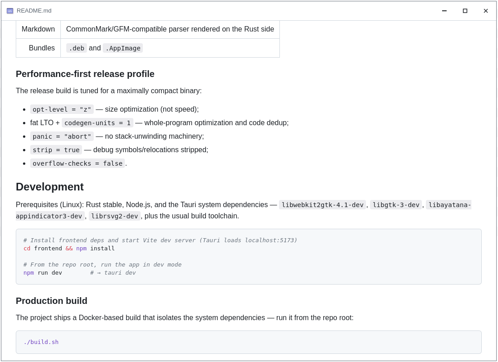

# md-viewer



A compact, high-performance desktop Markdown viewer built with **Rust + Tauri 2 + Svelte**. Open a `.md` file and it renders the document full-screen across the entire window — no menus, no clutter, just content.

## Features

- **Full-window rendering** — the document occupies every pixel of the window; the only chrome is a slim, frameless title bar with minimize / maximize / close buttons.
- **Server-side Markdown rendering** — parsing happens in Rust via [`comrak`](https://github.com/kivik/comrak), which is faster and more compact than parsing in the browser.
- **GitHub Flavored Markdown extensions** — tables, strikethrough, task lists, and automatic links are enabled.
- **Syntax highlighting** — code fences are highlighted with [`syntect`](https://github.com/servo/syntect). TypeScript (`typescript` / `ts` / `tsx`), `shell`, and `dotenv` fences are aliased to their nearest built-in grammar (`js`, `bash`, `properties`).
- **Automatic light/dark themes** — styling follows the system `prefers-color-scheme`, including the syntax-highlight palette.
- **Smart link handling** — clicking a link:
  - `http`/`https` and other schemes (`mailto:`, `tel:`, …) open in the system's default handler;
  - local `.md` paths (including relative ones) open in a **new instance** of the app, resolved against the current document's directory.
- **Drag-to-move frameless window** — drag the title bar to reposition; the control buttons never start a drag.

## Usage

```sh
md-viewer path/to/file.md
```

The executable takes the **relative or absolute path to a `*.md` file** as its first argument. Relative paths are resolved against the current working directory. If the file can't be read, an error message is shown in place of the document.

## Tech Stack

| Layer | Technology |
|------:|:-----------|
| Backend | Rust (2021 edition), Tauri 2, `comrak`, `syntect`, `opener` |
| Frontend | Svelte 5 with **Svelte 4 syntax** (`runes` disabled), Vite |
| Markdown | CommonMark/GFM-compatible parser rendered on the Rust side |
| Bundles | `.deb` and `.AppImage` |

### Performance-first release profile

The release build is tuned for a maximally compact binary:

- `opt-level = "z"` — size optimization (not speed);
- fat LTO + `codegen-units = 1` — whole-program optimization and code dedup;
- `panic = "abort"` — no stack-unwinding machinery;
- `strip = true` — debug symbols/relocations stripped;
- `overflow-checks = false`.

## Development

Prerequisites (Linux): Rust stable, Node.js, and the Tauri system dependencies — `libwebkit2gtk-4.1-dev`, `libgtk-3-dev`, `libayatana-appindicator3-dev`, `librsvg2-dev`, plus the usual build toolchain.

```sh
# Install frontend deps and start Vite dev server (Tauri loads localhost:5173)
cd frontend && npm install

# From the repo root, run the app in dev mode
npm run dev        # → tauri dev
```

### Production build

The project ships a Docker-based build that isolates the system dependencies — run it from the repo root:

```sh
./build.sh
```

This builds the app plus the `.deb` and `.AppImage` bundles into `target/release/`, then:

1. Creates a `.desktop` launcher and copies `icon.png` next to the binary.
2. Restores file ownership to the host user (the container writes as root).
3. Re-packs the AppImage so it uses the **system** `libwebkit2gtk` instead of the webkit bundled inside the Docker image — the bundled webkit crashes on target systems (e.g. Ubuntu/Mesa) with `Could not create default EGL display`. This is the standard Tauri-on-Linux model: a system webkit2gtk is required at runtime.

Artifacts:
- Binary: `target/release/md-viewer`
- Debian package: `target/release/bundle/deb/md-viewer_0.1.0_amd64.deb`
- AppImage: `target/release/bundle/appimage/md-viewer_0.1.0_amd64.AppImage`

> If you build directly on the host with `yarn run build` / `tauri build`, make sure the GTK/WebKit **dev** packages are installed — the `gdk-3.0.pc` pkg-config file required by `gdk-sys` ships with `libgtk-3-dev`.

## Runtime notes

- **Software rendering is forced.** WebKitGTK without an available EGL display aborts with `Could not create default EGL display: EGL_BAD_PARAMETER`. To make the AppImage work regardless of environment, GPU compositing, the DMABUF renderer, and hardware acceleration are disabled, and Mesa `llvmpipe` is selected (`WEBKIT_DISABLE_*`, `LIBGL_ALWAYS_SOFTWARE`).
- The frameless window draws its own title bar and buttons because on some systems the window manager paints the system frame and it can't be recolored from the app. The required window commands are granted through the `capabilities` permissions.

## Project layout

```
├── src/            Rust backend (main.rs, lib.rs)
├── frontend/       Svelte + Vite frontend (App.svelte, styles.css)
├── build.sh        Docker build + AppImage re-pack script
├── Dockerfile.build  Build image with system deps
├── tauri.conf.json Tauri config (deb + appimage targets)
└── capabilities/   Window-command permissions
```
